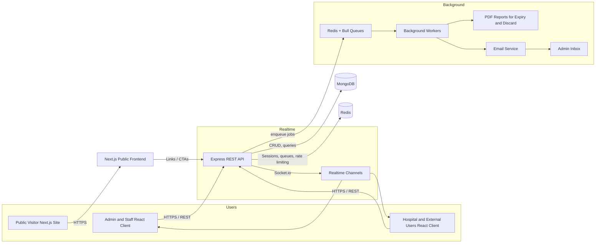
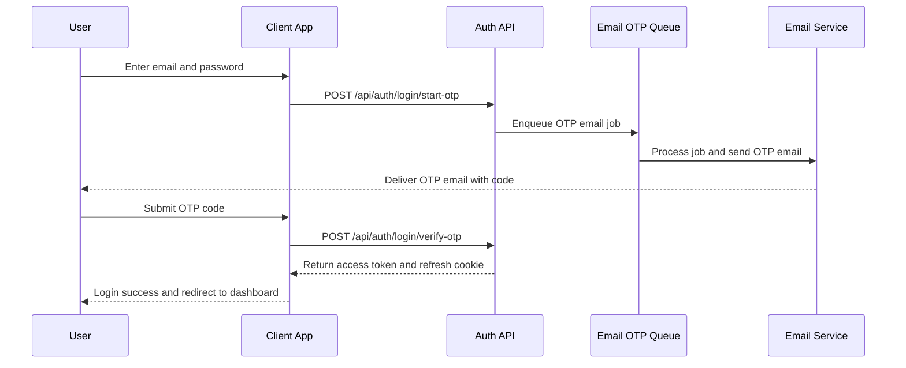
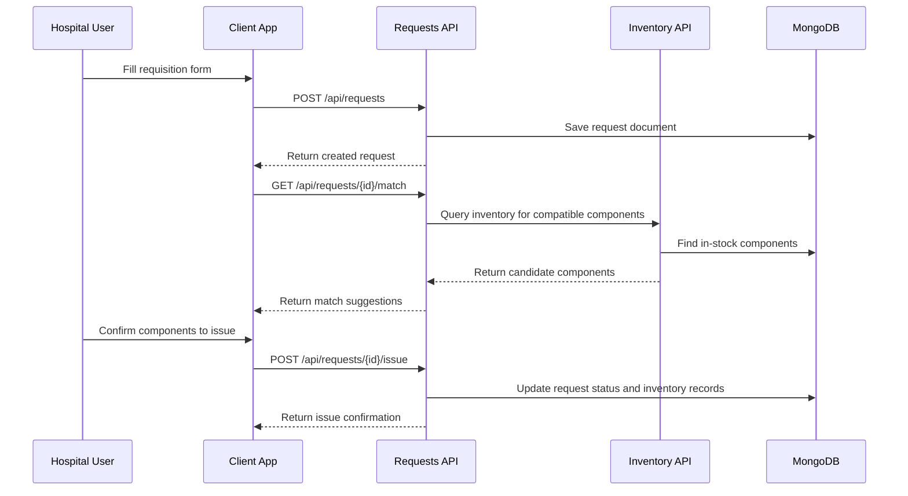

# Blood Bank Management System

A full-stack Blood Bank Management System designed to digitize and streamline end-to-end blood bank operations:

- **Donor registration & screening**
- **Blood donation & lab/serology testing**
- **Component separation & inventory management**
- **Hospital / internal requisitions and issue**
- **Near-expiry monitoring, PDF reporting & discard management**
- **Role-based access, logging, security & automation**

This repository is a **monorepo** containing the admin/client application, backend API, and a public-facing landing site.

---

## Monorepo Structure

```bash
blood-bank/
├── client/           # React + Vite admin/staff application
├── server/           # Node.js + Express REST API, queues, jobs
├── public-frontend/  # Next.js public/marketing site
└── README.md         # You are here
```

### `client/` – Admin & Operational UI

- **Tech**: React, Vite, Axios, Context-based auth, componentized pages.
- **Purpose**: Internal blood bank staff and admins manage donors, donations, inventory, hospitals, requests, MIS, etc.
- **Key feature areas** (see `client/src/page/`):
  - `donor/` – Donor registration & management.
  - `donation/` – Blood bag collection.
  - `Serology/` – Lab / serology results.
  - `component-separate/` – Separation of whole blood into components.
  - `Inventory/` – Inventory of components (RBC, Platelets, FFP, Cryo, etc.).
  - `hospital/` – Hospital master data and integrations.
  - `requisition/` – Requests / requisitions from hospitals.
  - `mis/` – MIS / reporting modules.
  - `camp/` – Camps, camp reports, and related flows.
  - `user-manage/`, `dashboard/`, etc.

Client communicates with the API at `VITE_APP_URI_API` (see `client/.env`). By default:

```env
VITE_APP_URI_API=http://localhost:5000
```

### `server/` – REST API, Jobs, Queues

- **Tech**: Node.js, Express, MongoDB (Mongoose), Redis, Bull queues, Socket.io, Winston logging, Helmet, JWT.
- **Purpose**: Provides all APIs, background jobs, PDF report generation, email notifications, and security.
- **Key folders** (also documented in `server/README.md`):
  - `controllers/` – Request handlers for each domain (donor, donation, components, inventory, hospital, request, MIS, etc.).
  - `routers/` – Route definitions (e.g. `/api/donor`, `/api/donation`, `/api/component`, `/api/hospitals`, `/api/inventory`, `/api/requests`, `/api/mis`, etc.).
  - `models/` – MongoDB models (BloodBag, Component, Donor, Hospital, Site, Users, etc.).
  - `queues/` – Bull queue definitions (expiry queue, discard queue, email OTP queue).
  - `jobs/` – Background jobs (e.g. `expiry-report-job.js`).
  - `services/` – Business logic & integration (expiry calculations, email service, PDF report generation).
  - `lib/` – Shared libraries (`pdfGenerator.js`, `discard-pdfGenerator.js`, `smsClient.js`, etc.).
  - `config/` – DB, Redis and mail configuration.

The main entrypoint is `server/server.js`, which:

- Sets up Express, CORS, Helmet, rate limiting and logging.
- Connects to MongoDB and Redis.
- Initializes queues (`expiry-queue`, `discard-queue`, `email-otp-queue`).
- Exposes REST endpoints under `/api/...`.
- Provides `/health` for basic health checks.

### `public-frontend/` – Public Landing / Marketing Site

- **Tech**: Next.js (App Router), React.
- **Purpose**: Public-facing landing site for the blood bank / platform, with marketing content, informational pages, and CTAs.
- Talks to the same backend where needed, or acts as an entry point redirecting to login / registration flows on the main client.

---

## High-Level System Architecture (Flow Chart)



**What this shows:**

- Internal users (admins, staff, hospitals) use the **React client** (`client/`) to access features via the **Express API** (`server/`).
- The **Next.js public site** (`public-frontend/`) exposes public-facing pages and can link into the main app.
- The API persists data in **MongoDB**, uses **Redis** for caching, rate limiting and job queues, and communicates real-time through **Socket.io**.
- Background workers generate **PDF reports** and send **emails** (e.g., daily near-expiry reports).

---

## Core Business Flow – Blood Lifecycle (Flow Chart)

```mermaid
flowchart LR
  DonorReg[Donor Registration] --> Screening[Medical Screening and Eligibility]
  Screening -->|Eligible| Donation[Blood Donation - Blood Bag Collection]
  Screening -->|Not eligible| EndScreen[Donor Deferred]

  Donation --> Lab[Serology / Lab Testing]
  Lab -->|Pass| CompSep[Component Separation]
  Lab -->|Fail| DiscardLab[Mark Unit as Discarded]

  CompSep --> Inventory[Component Inventory - RBC, Platelets, FFP, Cryo]

  Inventory --> Request[Hospital / Internal Request]
  Request --> Matching[Match & Reserve Components]
  Matching --> Issue[Issue / Transfusion]
  Matching -->|No match or expired| DiscardIssue[Discard / Return to Inventory]

  Inventory --> NearExpiry[Near Expiry Monitoring]
  NearExpiry --> ExpiryQueue[Expiry Report Queue]
  ExpiryQueue --> ExpiryJob[Expiry Report Job]
  ExpiryJob --> ExpiryPDF[Near-Expiry PDF Report]
  ExpiryPDF --> ExpiryEmail[Email to Admin]
  ExpiryEmail --> ReviewAction[Admin Review and Action - Transfer, Discard, Prioritize]
```



**Where this lives in code:**

- Donor, donation, lab, component separation, inventory, requests and issue flows are primarily handled under:
  - Controllers: `server/controllers/*-controller.js`
  - Routers: `server/routers/*-routes.js`
  - Models: `server/models/*.js`
- Near-expiry monitoring and reporting:
  - Queue definition: `server/queues/expiry-queue.js`
  - Job processor: `server/jobs/expiry-report-job.js`
  - Business logic and PDF generation: `server/services/blood-expiry-service.js`, `server/lib/pdfGenerator.js`.

---

## Major Functional Modules

Below is a high-level outline of the main functional areas and how they fit together.

- **Donor Management**
  - Register and maintain donor records.
  - Track donor history and status.

- **Donation & Blood Bag Management**
  - Create blood bag entries when donations occur.
  - Associate donors, blood group, RH, collection date, and site.

- **Serology / Lab**
  - Record lab test results for donations.
  - Mark units as safe/unsafe; unsafe units route to discard flows.

- **Component Separation**
  - Separate whole blood into components (RBC, Platelets, FFP, Cryo, etc.).
  - Track component type, volume, expiry date, storage, and linkage to original blood bag.

- **Inventory Management**
  - Maintain inventory of all components.
  - Support filters by blood group, component type, site, status, and expiry.

- **Hospital Management**
  - Manage hospital master data and contact details.
  - Link requisitions and issues to hospitals.

- **Requests / Requisitions**
  - Capture blood component requests from hospitals or internal departments.
  - Match requests to inventory and reserve / issue components.

- **Transfusion / Issue**
  - Record units issued for transfusion.
  - Track which components were used, for whom, and when.

- **Discard Management**
  - Track components or bags marked for discard (e.g., lab-failed, expired, damaged).
  - Generate discard reports and maintain an audit trail.

- **Camps**
  - Manage donation camps, camp donors, and camp-specific reports.

- **MIS & Reporting**
  - Provide operational and managerial reports (donor statistics, inventory, usage, expiry, etc.).

- **User, Auth & Admin**
  - Role-based access: admin, staff, developer (and other roles as configured).
  - JWT-based authentication, OTP login/registration flows, and session management.

## Key Workflows (Step-by-Step)

- **Authentication & OTP Login**
  1. User opens the client login page.
  2. Submits credentials, which are sent to `/api/auth/login` or `/api/auth/login/start-otp`.
  3. For OTP flows, an email is sent via the email-OTP job and queue.
  4. User verifies OTP via `/api/auth/login/verify-otp`; the backend issues a JWT access token and refresh cookie.
  5. The client stores the access token in memory/context and attaches it to subsequent API requests.

- **Requisition → Matching → Issue**
  1. A hospital or internal department creates a component request from the client UI.
  2. The backend validates the request and searches inventory for compatible components.
  3. Matching components are reserved against the request.
  4. On confirmation, reserved units are issued and the request is marked completed or partially completed.
  5. Inventory, audit, and MIS statistics are updated.

- **Camp Workflow**
  1. Admin configures a donation camp (site, date, organizers, targets).
  2. Camp donors are registered and donations recorded under the camp.
  3. Lab/serology, component separation, and inventory flows proceed as for regular donations.
  4. Camp reports summarize donors, units collected, and outcomes.

- **Expiry & Discard Workflow**
  1. Inventory is monitored for near-expiry components based on thresholds per component type.
  2. The scheduled expiry job generates a near-expiry PDF report and emails it to the admin.
  3. Admin reviews the report and may prioritize use, transfer, or discard of units.
  4. Discarded units are recorded via discard controllers/routes and appear in discard/MIS reports.

- **MIS Reporting Workflow**
  1. Operational data is generated continuously from donors, donations, components, inventory, and requests.
  2. The MIS module queries MongoDB via MIS controllers/routes to aggregate KPIs (e.g., units collected, issued, discarded, near-expiry counts).
  3. The client renders MIS dashboards and reports with filters (date range, blood group, component type, site, hospital).
  4. Users can export or print reports for audits, compliance, and management review.

- **Audit Logging Workflow**
  1. Critical actions (create/update/delete on donors, donations, components, inventory, requests, hospitals, and users) are captured in audit logs.
  2. The backend records who performed the action, what changed, and when, via audit controllers/models.
  3. Authorized users can review audit history to trace changes, support investigations, and ensure regulatory compliance.

- **Camp Reporting Workflow**
  1. For each camp, all registered donors and donations are linked to the camp record.
  2. The MIS/camp reports module summarizes total donors, successful donations, deferrals, and component output by camp.
  3. Users can break down results by blood group, site, date, and other filters to evaluate camp performance.

---

## Detailed Auth & OTP Sequence (Diagram)



---

## Detailed Requisition & Matching Sequence (Diagram)



---

## Module to Screen Map (Quick Reference)

| Area              | Backend (examples)                             | Client (examples)                         | Description |
|-------------------|-------------------------------------------------|-------------------------------------------|-------------|
| Donor             | `/api/donor` (donor-routes, donor-controller)  | `client/src/page/donor`                   | Donor registration, update, listing. |
| Donation          | `/api/donation` (donation-routes)              | `client/src/page/donation`                | Create and manage blood bag donations. |
| Serology / Lab    | `/api/sernology` (lab-routes)                  | `client/src/page/Serology`                | Record lab test results and mark units safe/unsafe. |
| Components        | `/api/component` (component-routes)            | `client/src/page/component-separate`      | Separate whole blood into components and track component details. |
| Inventory         | `/api/inventory` (inventory-routes)            | `client/src/page/Inventory`               | View and manage component stock, filters, and statuses. |
| Hospitals         | `/api/hospitals` (hospital-routes)             | `client/src/page/hospital`                | Maintain hospital master data and contacts. |
| Requests/Requisition | `/api/requests` (request-routes)           | `client/src/page/requisition`             | Capture and manage component requests, matching, and issue. |
| Transfusion/Issue | `/api/transfusion` (transfusion-routes)        | Related issue screens within requisition   | Record issued units and transfusion details. |
| Discard           | `/api/discard` (discard-routes)                | Discard-related views in inventory/MIS     | Mark and report discarded units (expired, lab failed, damaged). |
| Camps             | Camp-related APIs (within donation/site flows) | `client/src/page/camp`                    | Configure camps, link donors/donations, and view camp reports. |
| MIS & Reports     | `/api/mis`, `/api/report` (mis/report-routes)  | `client/src/page/mis`                     | Aggregate operational KPIs and generate MIS reports. |
| Users & Admin     | `/api/users`, `/api/admin`                     | `client/src/page/user-manage`, dashboard  | Manage users, roles, and admin operations. |

---

## Running the Project Locally

### Prerequisites

- **Node.js** (LTS recommended)
- **MongoDB** (local or remote instance)
- **Redis** (for queues and rate limiting)

### 1. Backend – `server/`

See `server/README.md` for full details. In short:

1. Navigate to the server folder:

   ```bash
   cd server
   ```

2. Install dependencies:

   ```bash
   npm install
   ```

3. Create `.env` in `server/` (minimal example – see `server/README.md` for all options):

   ```env
   MONGODB_URI=mongodb://localhost:27017/BloodBank
   REDIS_URL=redis://localhost:6379

   EMAIL_USER=your-email@gmail.com
   EMAIL_PASS=your-app-password
   ADMIN_EMAIL=admin@bloodbank.com

   PORT=5000
   NODE_ENV=development

   REPORTS_DIR=./reports
   NEAR_EXPIRY_DAYS=5

   JWT_SECRET=your-jwt-secret-key
   JWT_EXPIRES_IN=7d

   TIMEZONE=Asia/Kolkata
   ```

4. Start the backend server:

   ```bash
   npm start
   ```

The API should now be available at `http://localhost:5000`.

### 2. Admin / Client App – `client/`

1. Navigate to the client folder:

   ```bash
   cd client
   ```

2. Install dependencies:

   ```bash
   npm install
   ```

3. Configure `.env` (already present in this repo, adjust as needed):

   ```env
   VITE_APP_URI_API=http://localhost:5000
   ```

4. Start the development server:

   ```bash
   npm run dev
   ```

5. Open the app in your browser (typically `http://localhost:5173`).

### 3. Public Frontend – `public-frontend/`

1. Navigate to the folder:

   ```bash
   cd public-frontend
   ```

2. Install dependencies:

   ```bash
   npm install
   ```

3. Start the Next.js dev server:

   ```bash
   npm run dev
   ```

4. Open `http://localhost:3000` to view the public site.

---

## Background Jobs & Automation

The system uses **Bull queues** and **Redis** for background processing:

- **Expiry Report Queue** (`server/queues/expiry-queue.js`)
  - Scheduled daily (08:00 IST in production) to check for near-expiry components.
  - Uses `server/services/blood-expiry-service.js` to:
    - Find near-expiry components with **component-specific thresholds**.
    - Generate a professional **PDF report** via `server/lib/pdfGenerator.js`.
  - Sends the PDF via email using `server/services/email-service.js`.

- **Discard / Other Queues**
  - Additional queues for discard management and OTP/email flows (see `server/queues/*`, `server/jobs/*`).

These jobs run automatically when the `server` process is up and Redis is available.

---

## Security, Logging & Monitoring (Server)

For detailed notes, see `server/README.md`. In summary:

- **Security**
  - `helmet` for HTTP security headers.
  - CORS with an allowlist of frontend origins.
  - Rate limiting and DDoS mitigation using `express-rate-limit` and `rate-limiter-flexible` backed by Redis.
  - JWT authentication for API access, with refresh and logout flows.
  - Input validation and structured error handling middleware.

- **Logging**
  - Centralized logging via Winston.
  - Logs HTTP requests, queue events, job start/completion/failure, and errors.

- **Monitoring**
  - `/health` endpoint for health checks.
  - Queue logging (jobs enqueued, running, completed, failed).

---

## Contributing

- **Follow existing patterns** in controllers, routers, and React pages.
- **Error handling**: Always return structured error responses and log internal errors via the logger.
- **Security**: Respect authentication/authorization checks and validation.
- **Documentation**: Update this `README.md` and/or `server/README.md` when you add or modify significant flows (API endpoints, queues, jobs, or modules).
- **Testing**: Exercise critical flows (donation → lab → component separation → inventory → request → issue / discard, and expiry reporting) after changes.

---

## Further Reading

- [`server/README.md`](./server/README.md) – deep dive into backend features, environment variables, error handling, logging and troubleshooting.
- `client/src/page/` – main functional pages for donors, donations, components, inventory, requests, hospitals, MIS, camps and more.
- `server/controllers/` and `server/routers/` – domain-specific business logic.
